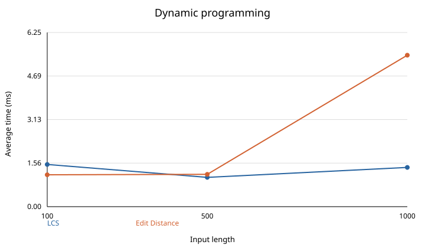
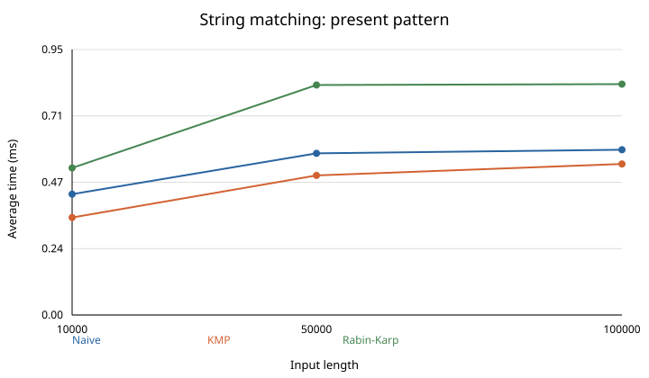
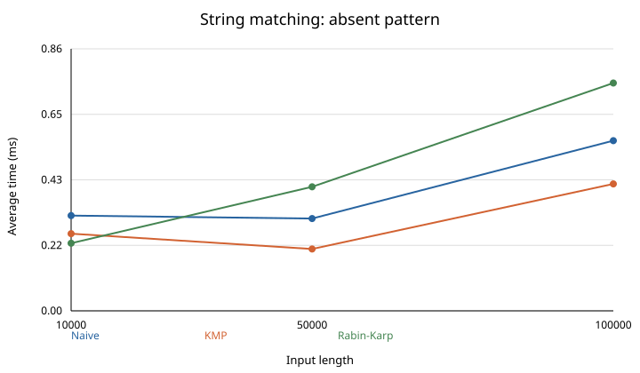

# Assignment 4: Text Analysis

In this assignment I implemented LCS, edit distance, naive search, KMP, Rabin-Karp and Kasai's algorithm. I tested them and compared their running times.

## How to run

```bash
mkdir -p target/classes
javac -d target/classes $(find src -name '*.java')
java -cp target/classes tests.Tests
java -cp target/classes experiments.Benchmark > results/results.csv
python3 make_plots.py
```

The last two commands run the experiments and update the plots.

## Algorithms

**LCS:** The table stores the LCS length for each pair of prefixes. If the last characters match, I add 1 to the previous diagonal cell. Otherwise, I take the larger value from the cell above or to the left. An empty prefix has an LCS of 0. This works because when the last characters differ, at least one of them has to be left out.

**Edit distance:** Each cell stores the distance between two prefixes. I take the minimum cost of inserting, deleting or replacing a character. If the characters match, the replacement cost is 0. The first row and column represent changes from an empty string. These choices cover all possible last steps.

**Naive:** I check the pattern at every possible position in the text.

**KMP:** I build an LPS array for the pattern. After a mismatch, it tells me where to continue without checking the same matched characters again.

**Rabin-Karp:** I compare hashes of the pattern and each text window. If the hashes match, I also compare the characters because different strings can have the same hash.

**Kasai:** Given a sorted suffix array, it builds an LCP array. Each LCP value is the number of matching characters at the start of two neighboring suffixes. The first value is 0. Kasai reuses the previous match to avoid starting every comparison from scratch. It expects a valid sorted suffix array.

For example, for `banana`:

- Suffix array: `[5, 3, 1, 0, 4, 2]`
- LCP array: `[0, 1, 3, 0, 0, 2]`

The search algorithms return all starting indices, including overlapping matches. An empty pattern matches at every position from 0 to the text length. A pattern longer than the text has no matches. Strings are compared using Java characters (UTF-16 code units).

## Complexity

Here `n` and `m` are the lengths of the two strings, or the text and pattern for search. Search space does not include the list of matches. These are theoretical bounds.

| Algorithm | Main operation | Best time | Worst time | Space | Why |
| --- | --- | --- | --- | --- | --- |
| LCS | Fill the DP table | O((n+1)(m+1)) | O((n+1)(m+1)) | O((n+1)(m+1)) | Each table cell is filled once. |
| Edit distance | Fill the DP table | O((n+1)(m+1)) | O((n+1)(m+1)) | O((n+1)(m+1)) | Each table cell is filled once. |
| Naive | Compare at each position | O(n-m+1) | O((n-m+1)m) | O(1) | Each position can take one comparison or up to m comparisons. |
| KMP | Build LPS and search | O(n+m) | O(n+m) | O(m) | Building LPS and searching are both linear. |
| Rabin-Karp | Update and compare hashes | O(n+m) | O(nm) | O(1) | Hash updates are fast, but matching hashes need character checks. |
| Kasai | Compare neighboring suffixes | O(n) | O(n) | O(n) | Previous matches are reused, so the total work is linear. |

For the search bounds, the pattern is nonempty and no longer than the text. Rabin-Karp usually takes O(n+m) when there are few hash matches to check. Many collisions or actual matches can make it take O(nm). An empty pattern returns n+1 positions and takes O(n) time and output space.

## Tests

I tested empty and identical strings, different strings, and insertion, deletion and substitution for the DP algorithms. For search I tested matches at the beginning, middle and end, repeated matches, absent patterns, longer patterns and empty patterns. All three algorithms are checked against the same expected indices. I also compared them on 1,000 random cases.

For Kasai I tested `banana` using the suffix and LCP arrays above, as well as an empty string. All tests passed.

## Experiments

I ran the experiments on OpenJDK 17 in WSL2. The random strings use `a`, `b`, `c`, `d` and seed 42. For LCS and edit distance, both strings have length 100, 500 or 1,000. For search, the text lengths are 10,000, 50,000 and 100,000, and the patterns have length 16. I tested both present and absent patterns using the same inputs for all three algorithms. For Kasai, the lengths are 1,000, 5,000 and 10,000.

Each algorithm was warmed up and then run 5 times on the same input. I used `System.nanoTime()` and calculated the average. Input generation, printing, file operations and suffix array construction are outside the timed part. The search comparison counts do not include KMP preprocessing or hash calculations. The full results are in [results.csv](results/results.csv).

### Dynamic programming

| Length | LCS (ms) | Edit distance (ms) |
| ---: | ---: | ---: |
| 100 | 1.515 | 1.145 |
| 500 | 1.052 | 1.161 |
| 1000 | 1.409 | 5.439 |



### String matching

| Text length | Pattern | Naive ms / comparisons | KMP ms / comparisons | Rabin-Karp ms / comparisons |
| ---: | --- | ---: | ---: | ---: |
| 10000 | present | 0.431 / 13353 | 0.348 / 12448 | 0.524 / 16 |
| 10000 | absent | 0.314 / 13290 | 0.254 / 12537 | 0.223 / 0 |
| 50000 | present | 0.576 / 66500 | 0.497 / 62355 | 0.820 / 16 |
| 50000 | absent | 0.304 / 66656 | 0.204 / 62411 | 0.409 / 0 |
| 100000 | present | 0.589 / 133408 | 0.538 / 125026 | 0.823 / 16 |
| 100000 | absent | 0.560 / 133285 | 0.418 / 125002 | 0.750 / 0 |





### Kasai

| Length | Average time (ms) |
| ---: | ---: |
| 1000 | 0.215 |
| 5000 | 0.253 |
| 10000 | 0.403 |

## Discussion and conclusion

The DP algorithms fill a table, so their time and space grow with both string lengths. The measured times are not perfectly smooth, especially for small inputs. JVM warm-up and other work on the computer can affect them.

KMP used fewer character comparisons than naive search in these tests. Rabin-Karp checked very few characters, but calculating hashes still took time. Naive search is simple, KMP has a better worst case, and Rabin-Karp can slow down when many hashes match. Kasai was fast on these inputs, but it needs a suffix array first.
